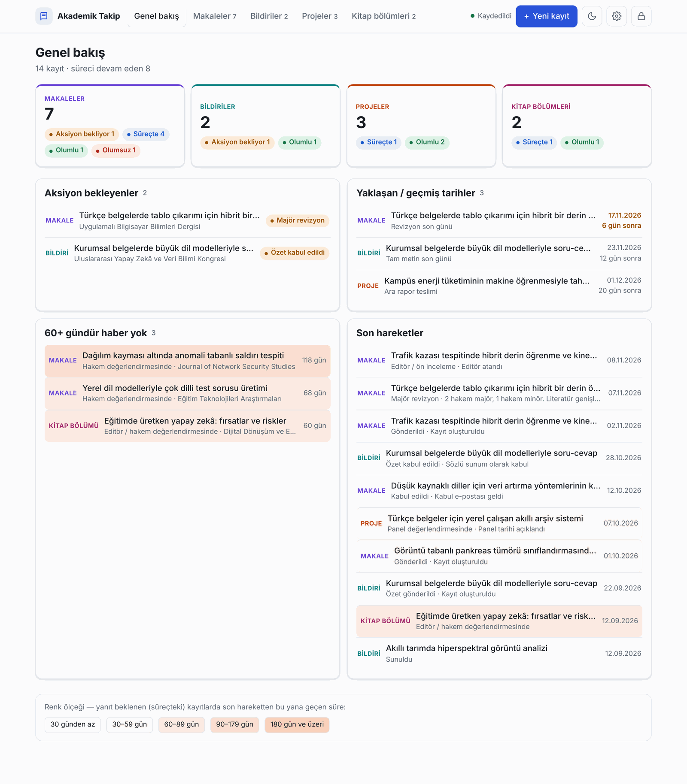
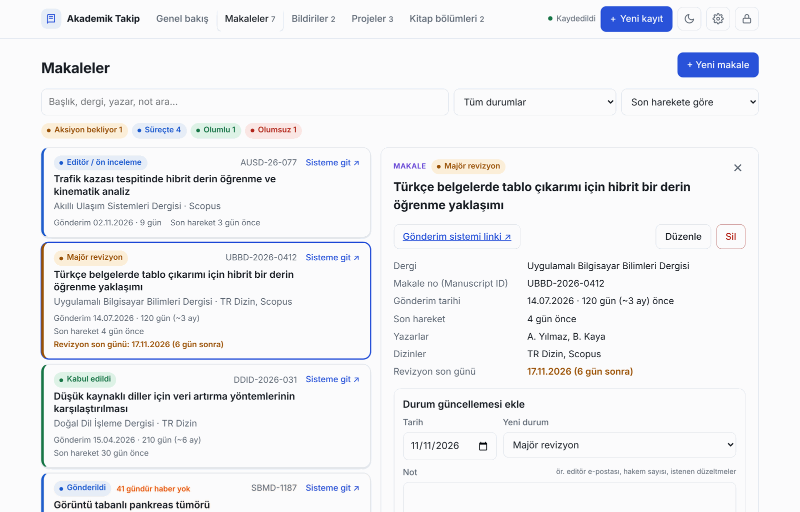
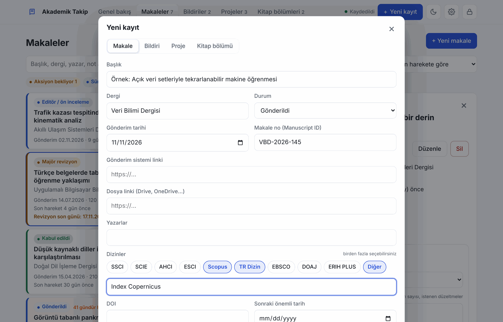
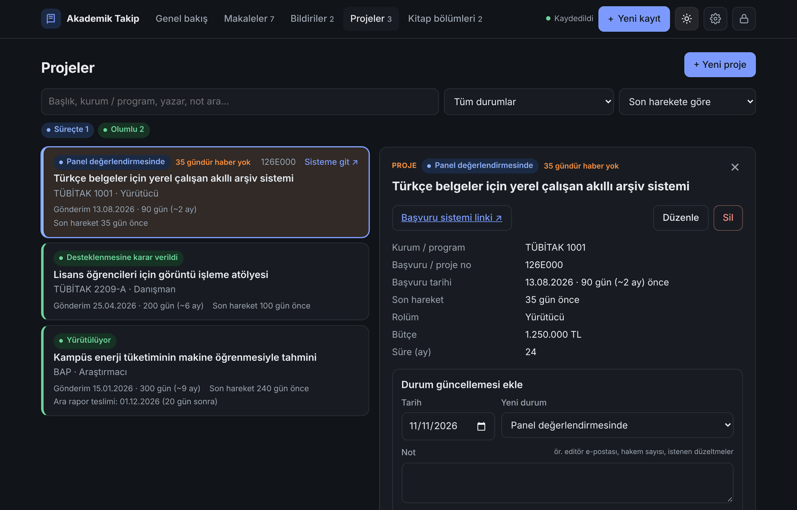
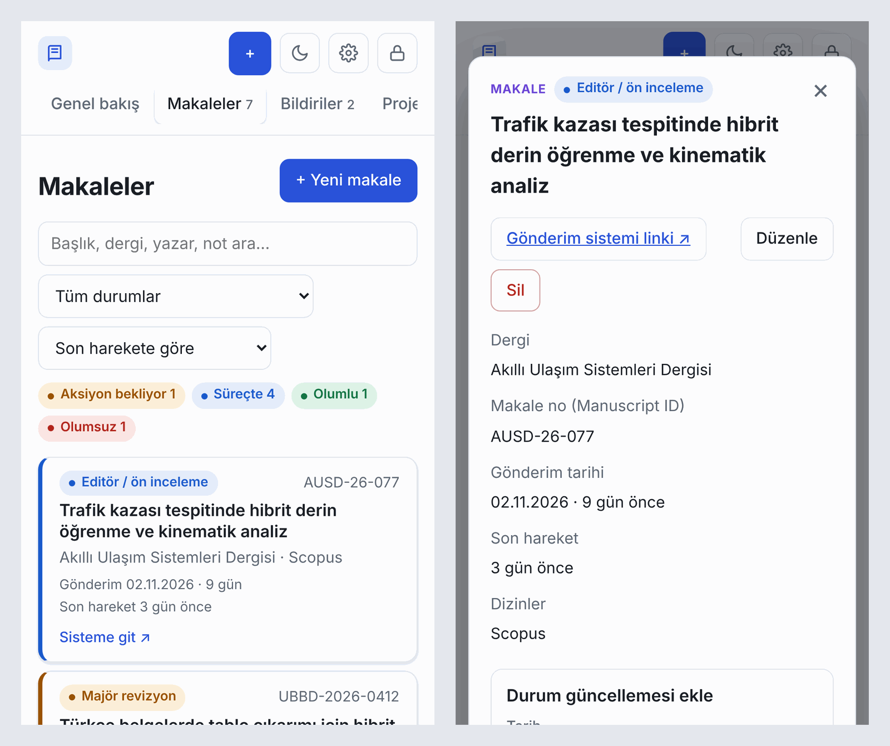
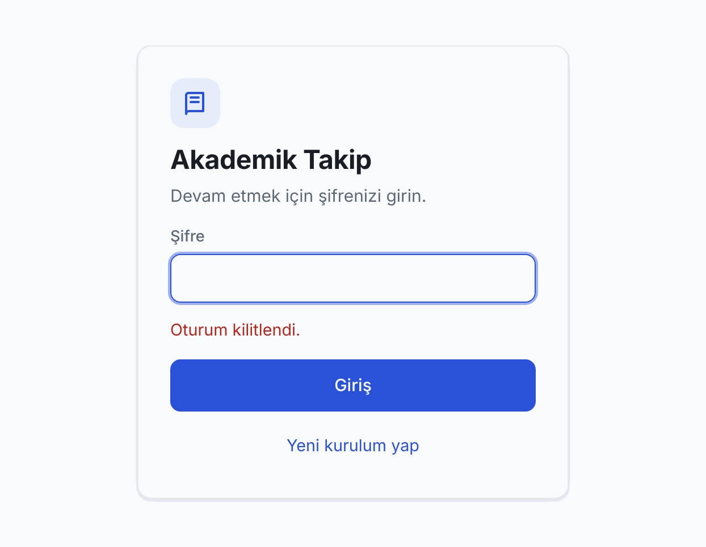
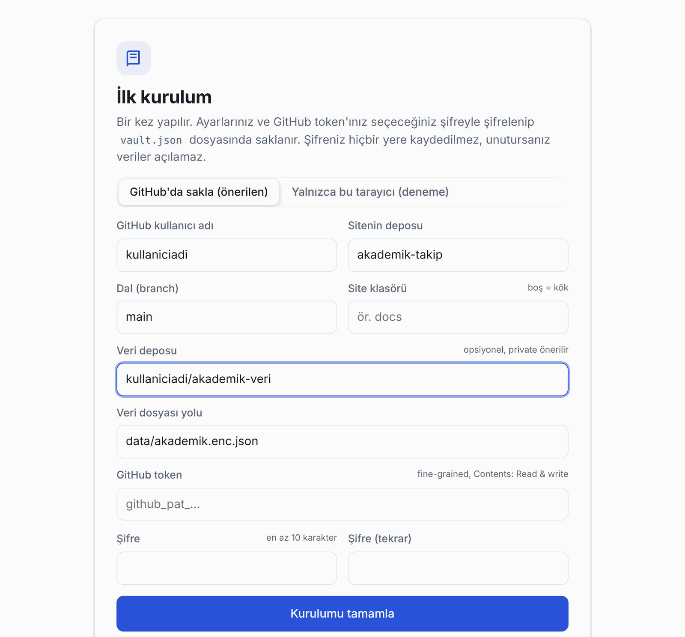

<div align="center">

# 📚 Akademik Takip

**Makale, bildiri, proje ve kitap bölümü başvurularınızı tek yerden takip edin.**

Nereye, ne zaman gönderdiniz? Şu an hangi aşamada? Ne zamandır haber yok? Revizyonun son günü ne zaman?
Hepsi tek ekranda, şifreli ve yalnızca sizin erişiminizde.



`GitHub Pages` · `Sunucu yok` · `Ücretsiz` · `Uçtan uca şifreli` · `Mobil uyumlu` · `Açık / koyu tema`

</div>

---

## İçindekiler

- [Özellikler](#-özellikler)
- [Ekran görüntüleri](#-ekran-görüntüleri)
- [Gizlilik ve güvenlik](#-gizlilik-ve-güvenlik)
- [Kurulum](#-kurulum-yaklaşık-10-dakika)
- [Kullanım](#-kullanım)
- [Durumlar ve renkler](#-durumlar-ve-renkler)
- [Güncelleme ve yedekleme](#-güncelleme-ve-yedekleme)
- [Sık sorulan sorular](#-sık-sorulan-sorular)

---

## ✨ Özellikler

| | |
|---|---|
| 📝 **Dört kayıt türü** | Makaleler, bildiriler, projeler (TÜBİTAK, BAP, AB…) ve kitap bölümleri; her biri kendi durum adımlarıyla |
| 🔗 **Tüm bilgiler tek kayıtta** | Dergi/kongre/program, gönderim tarihi, makale veya başvuru numarası, gönderim sistemi linki, dosya linki, yazarlar |
| 🏷️ **Çoklu dizin** | Bir makaleye SSCI, SCIE, ESCI, Scopus, TR Dizin… birden fazla dizin; listede olmayanı "Diğer" ile yazabilirsiniz |
| 🕒 **Süreç geçmişi** | Her durum değişikliği tarih ve notuyla zaman çizelgesine eklenir (ör. "2 hakem majör, ek deney istendi") |
| ⏰ **Sonraki önemli tarih** | Revizyon son günü, tam metin teslimi, ara rapor… 30 gün önceden genel bakışta görünür |
| 🎨 **Bekleme süresine göre renk** | Uzun süredir yanıt alınamayan kayıtlar giderek koyulaşan turuncu tonlarla öne çıkar |
| 🗂️ **Liste ve yan panel** | Kayıtlar alt alta listelenir; tıkladığınız kaydın ayrıntıları yanda açılır |
| 🔍 **Arama, filtre, sıralama** | Başlık, dergi, yazar, dizin veya notlarda arama; duruma göre filtreleme |
| 📤 **Dışa aktarma** | JSON yedek ve Excel'de açılabilen CSV tablosu |
| 🔒 **Şifreli ve kişisel** | Veriler tarayıcıda şifrelenir; şifreniz olmadan hiç kimse okuyamaz |
| 📱 **Her cihazda** | Bilgisayar, tablet ve telefonda çalışır; aynı verilere her yerden erişirsiniz |

---

## 🖼️ Ekran görüntüleri

> Görüntülerdeki tüm kayıtlar örnek amaçlı ve kurgusaldır.

### Liste ve ayrıntı paneli
Kayıtlar alt alta sıralanır. Bir kayda tıkladığınızda ayrıntıları, durum güncelleme formu ve süreç geçmişi sağ tarafta açılır.



### Yeni kayıt
Kayıt türünü seçin, bilgileri doldurun. Makalelerde birden fazla dizin işaretleyebilirsiniz; "Diğer"i seçince serbest metin alanı açılır.



### Koyu tema
Üst çubuktaki ay/güneş simgesiyle tek tıkla açık ve koyu tema arasında geçebilirsiniz.



### Telefonda
Dar ekranlarda ayrıntılar açılır pencerede gösterilir.



### Giriş ve ilk kurulum

<table>
<tr>
<td width="50%"></td>
<td width="50%"></td>
</tr>
<tr>
<td align="center"><sub>Her girişte yalnızca şifre</sub></td>
<td align="center"><sub>Bir kez yapılan ilk kurulum</sub></td>
</tr>
</table>

---

## 🔐 Gizlilik ve güvenlik

GitHub Pages'te yayınlanan her sayfa herkese açıktır. Bu yüzden Akademik Takip gizliliği bir giriş ekranıyla değil, **şifrelemeyle** sağlar:

```
 Tarayıcınız                                 GitHub
┌──────────────────────────┐               ┌─────────────────────────────────┐
│ Şifreniz ──► anahtar     │               │ akademik-takip  (public)        │
│ (hiçbir yere kaydedilmez)│               │  ├─ index.html   uygulama       │
│                          │   yalnızca    │  └─ vault.json   şifreli ayarlar│
│ Kayıtlarınız ──► şifrele │ ── şifreli ─► │                                 │
│                          │    içerik     │ akademik-veri   (private)       │
│                          │               │  └─ data/akademik.enc.json      │
└──────────────────────────┘               └─────────────────────────────────┘
```

- **Şifreleme:** AES-256-GCM. Anahtar, şifrenizden PBKDF2-SHA256 (600.000 tur) ile türetilir.
- **GitHub'a giden her şey şifrelidir.** Site deposu herkese açık olsa da içindeki `vault.json` şifreniz olmadan okunamaz.
- **Token'ınız da şifreli saklanır.** Başka bir cihazda yalnızca şifrenizi girmeniz yeterlidir.
- **Veriler ayrı bir private depoda** durur. Böylece şifreli dosya bile herkese açık olmaz.
- **Otomatik kilit:** Belirlediğiniz süre boyunca işlem yapılmazsa oturum kilitlenir (varsayılan 30 dakika).

> [!WARNING]
> Şifreniz hiçbir yere kaydedilmez. **Unutursanız veriler kurtarılamaz.** Şifrenizi güvenli bir yere not edin ve düzenli yedek alın.

---

## 🚀 Kurulum (yaklaşık 10 dakika)

Her şey **GitHub'ın ücretsiz planıyla** çalışır.

> [!NOTE]
> Ücretsiz planda GitHub Pages yalnızca **public** depolarda çalışır. Bu yüzden site deposu public, veri deposu private olur. Verileriniz şifreli olduğu için public depoda bile okunamaz.

### 1. Site deposunu oluşturun
1. GitHub'da sağ üstteki **+ → New repository**'ye tıklayın.
2. Ad: `akademik-takip`, görünürlük: **Public**. "Add a README file" kutusunu işaretleyin.
3. **Add file → Upload files** ile `index.html` dosyasını yükleyin ve **Commit changes**'e basın.

### 2. GitHub Pages'i açın
1. Depoda **Settings → Pages** sayfasına girin.
2. **Source:** *Deploy from a branch*, **Branch:** `main`, klasör: `/ (root)` seçip **Save**'e basın.
3. 1–3 dakika sonra siteniz `https://KULLANICIADI.github.io/akademik-takip/` adresinde açılır.

### 3. Veri deposunu oluşturun
1. Yine **+ → New repository**.
2. Ad: `akademik-veri`, görünürlük: **Private**.
3. **"Add a README file" kutusunu mutlaka işaretleyin** (depo boş kalırsa uygulama yazamaz).

### 4. Erişim anahtarı (token) oluşturun
1. Profil resminiz → **Settings → Developer settings → Personal access tokens → Fine-grained tokens → Generate new token**.
2. **Expiration:** örneğin 1 yıl.
3. **Repository access:** *Only select repositories* → `akademik-takip` ve `akademik-veri`.
4. **Permissions → Repository permissions → Contents:** **Read and write**. Başka bir izne dokunmayın.
5. **Generate token**'a basın ve çıkan `github_pat_…` değerini kopyalayın; bir daha gösterilmez.

### 5. İlk kurulum
Sitenizi açın. Kurulum ekranında:

| Alan | Değer |
|---|---|
| GitHub kullanıcı adı / Sitenin deposu | Otomatik dolar |
| Veri deposu | `KULLANICIADI/akademik-veri` |
| GitHub token | Kopyaladığınız `github_pat_…` değeri |
| Şifre | En az 10 karakter. Uzun bir cümle iyi bir seçimdir. |

**Kurulumu tamamla**'ya basın. Uygulama gerekli dosyaları depolara kendisi yazar. Birkaç dakika sonra diğer cihazlarınızdan yalnızca şifrenizle giriş yapabilirsiniz.

> [!TIP]
> Telefonda siteyi açıp tarayıcı menüsünden **"Ana ekrana ekle"** derseniz uygulama gibi kullanabilirsiniz.

---

## 📖 Kullanım

### Yeni kayıt eklemek
Üstteki **+ Yeni kayıt** düğmesine basın, türü seçin (Makale / Bildiri / Proje / Kitap bölümü) ve bilgileri doldurun. Yalnızca başlık zorunludur.

### Durumu güncellemek
1. Listede kayda tıklayın; ayrıntılar yanda açılır.
2. **Durum güncellemesi ekle** bölümünde tarihi, yeni durumu ve isterseniz bir not girin.
3. Gerekirse **Sonraki tarih** alanına revizyon son günü gibi bir tarih ekleyin.
4. **Ekle**'ye basın. Adım süreç geçmişine eklenir ve kaydın durumu güncellenir.

### Genel bakış ekranı
| Bölüm | Ne gösterir? |
|---|---|
| **Aksiyon bekleyenler** | Sizden işlem bekleyen kayıtlar (revizyon, özet kabulü, ek bilgi talebi…) |
| **Yaklaşan / geçmiş tarihler** | Önümüzdeki 30 gün içindeki son tarihler; 7 günden az kalanlar vurgulanır |
| **60+ gündür haber yok** | Uzun süredir hareket olmayan süreçler; editöre hatırlatma yazmak için ideal |
| **Son hareketler** | Tüm kayıtlardaki en son durum değişiklikleri |

### Kayıt türlerine özel alanlar
| Tür | Ek alanlar |
|---|---|
| **Makale** | Dizinler (çoklu seçim + Diğer), DOI |
| **Bildiri** | Etkinlik tarihi, yer, sunum türü (sözlü/poster/çevrimiçi), yayın şekli |
| **Proje** | Rolünüz (yürütücü/araştırmacı/danışman/bursiyer), bütçe, süre, başlangıç tarihi |
| **Kitap bölümü** | Yayınevi, kitap editörleri, ulusal/uluslararası, ISBN, sayfa aralığı, DOI |

---

## 🎨 Durumlar ve renkler

### Durum grupları
Her durum beş gruptan birine aittir; listedeki rozetler ve kayıtların sol kenar rengi buna göre belirlenir.

| Grup | Anlamı | Örnek durumlar |
|---|---|---|
| ⚪ **Hazırlanıyor** | Henüz gönderilmedi | Hazırlanıyor |
| 🔵 **Süreçte** | Karşı taraftan yanıt bekleniyor | Gönderildi, Hakem değerlendirmesinde, Panel değerlendirmesinde |
| 🟠 **Aksiyon bekliyor** | Sıra sizde | Majör/minör revizyon, Özet kabul edildi, Ek bilgi istendi |
| 🟢 **Olumlu** | Sonuçlandı | Kabul edildi, Yayımlandı, Desteklendi, Sunuldu |
| 🔴 **Olumsuz** | Kapandı | Reddedildi, Desteklenmedi, Geri çekildi |

### Bekleme süresi renk ölçeği
**Süreçte** olan kayıtların arka planı, son hareketten bu yana geçen süreye göre koyulaşır ve kayıtta "… gündür haber yok" yazar. Ölçek her sayfanın altında da açıklama olarak gösterilir.

| Son hareketten bu yana | Görünüm |
|---|---|
| 30 günden az | Normal |
| 30–59 gün | Çok açık turuncu |
| 60–89 gün | Açık turuncu |
| 90–179 gün | Belirgin turuncu |
| 180 gün ve üzeri | Koyu turuncu |

---

## 🔄 Güncelleme ve yedekleme

### Uygulamayı güncellemek
Yeni bir `index.html` sürümü geldiğinde **Add file → Upload files** ile eskisinin üzerine yükleyin. **Kayıtlarınız silinmez**, çünkü veriler ayrı dosyalarda durur.

> [!IMPORTANT]
> - `vault.json` dosyasını **silmeyin**.
> - Giriş ekranındaki **"Yeni kurulum yap"** seçeneğini güncelleme için **kullanmayın**; o seçenek her şeyi sıfırdan kurar.
> - Güncellemeden sonra eski görünüm gelirse sayfayı **Ctrl + F5** ile yenileyin.

### Yedek almak
**Ayarlar (⚙️) → Yedek** bölümünden:
- **Yedek indir (JSON):** Tüm kayıtlarınızın tam yedeği. Gerekirse **Yedekten içe aktar** ile geri yüklenir.
- **Tablo indir (CSV):** Excel'de açılabilir liste; raporlama veya akademik teşvik başvuruları için kullanışlıdır.

> [!CAUTION]
> İndirilen yedek dosyaları **şifresizdir**. Güvenli bir yerde saklayın ve herkese açık bir depoya yüklemeyin.

---

## ❓ Sık sorulan sorular

<details>
<summary><b>GitHub'da ücretli bir plana ihtiyacım var mı?</b></summary>
<br>
Hayır. Public depoda GitHub Pages, private depolar ve fine-grained token'lar ücretsiz planda kullanılabilir.
</details>

<details>
<summary><b>Depom public. Başkaları makalelerimi görebilir mi?</b></summary>
<br>
Hayır. Public depoda yalnızca uygulama kodu ve şifreli <code>vault.json</code> bulunur. Kayıtlarınız private veri deposunda ve ayrıca şifreli olarak durur. Commit geçmişi ne zaman güncelleme yaptığınızı gösterebilir ama içeriği göstermez.
</details>

<details>
<summary><b>Şifremi unuttum, ne yapabilirim?</b></summary>
<br>
Şifre hiçbir yerde saklanmadığı için şifreli veriler açılamaz. Elinizde bir JSON yedeği varsa "Yeni kurulum yap" ile yeni bir şifre belirleyip yedeği içe aktarabilirsiniz.
</details>

<details>
<summary><b>"Token geçersiz ya da süresi dolmuş" uyarısı aldım.</b></summary>
<br>
Token'ın süresi dolmuştur. Kurulum bölümündeki 4. adımı tekrarlayarak yeni bir token oluşturun ve uygulamanın açtığı ekrana yapıştırın. Verileriniz etkilenmez.
</details>

<details>
<summary><b>Kurulumda "Depo bulunamadı" hatası alıyorum.</b></summary>
<br>
Genellikle şu üç nedenden biridir:
<ul>
<li>Token oluştururken iki depo da seçilmemiştir.</li>
<li>Contents izni <b>Read and write</b> yapılmamıştır.</li>
<li>Veri deposu adı <code>kullaniciadi/akademik-veri</code> biçiminde yazılmamıştır.</li>
</ul>
</details>

<details>
<summary><b>İki cihazda aynı anda düzenleme yaparsam ne olur?</b></summary>
<br>
Uygulama çakışmayı fark eder ve size <b>Birleştir</b> seçeneği sunar. İki taraftaki kayıtlar birleştirilir; aynı kayıt iki yerde değiştiyse en son düzenlenen kalır.
</details>

<details>
<summary><b>İnternet olmadan çalışır mı?</b></summary>
<br>
Hayır. Veriler GitHub'da saklandığı için giriş ve kayıt sırasında internet bağlantısı gerekir.
</details>

---

## 📁 Depo yapısı

```
akademik-takip/                 (public, GitHub Pages)
├── index.html                  Uygulamanın tamamı
├── vault.json                  Şifreli ayarlar (ilk kurulumda otomatik oluşur)
├── README.md                   Bu dosya
└── ekran-goruntuleri/          README görselleri

akademik-veri/                  (private)
└── data/akademik.enc.json      Şifreli kayıtlar (otomatik oluşur)
```

<div align="center">
<br>
<sub>Tek bir HTML dosyası · Harici kütüphane yok · Sunucu yok</sub>
</div>
